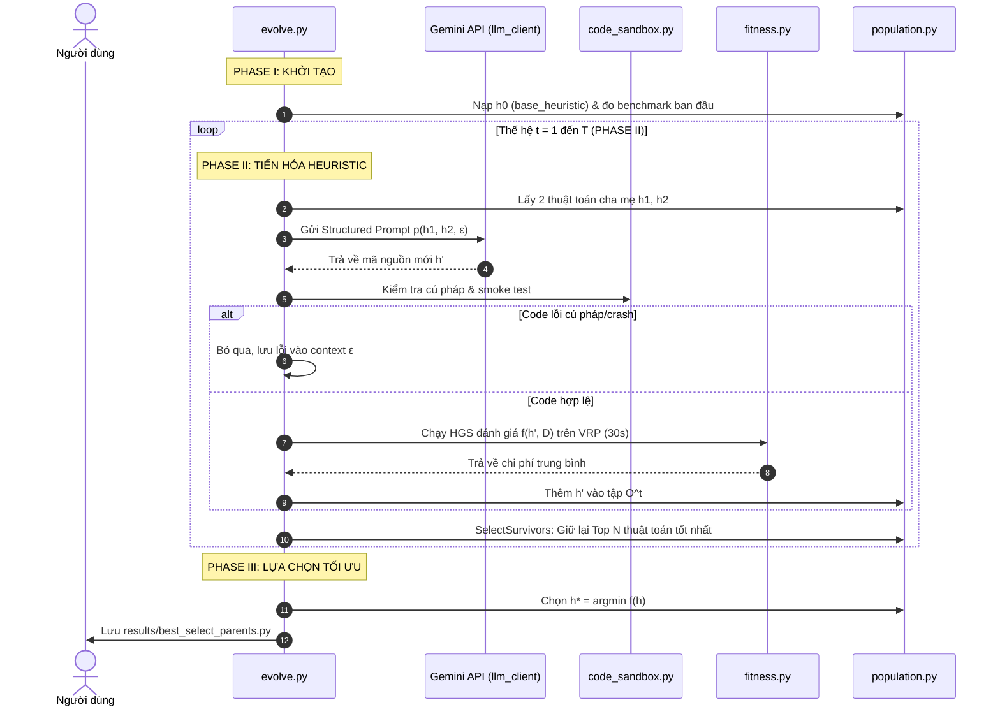

# GIẢI THÍCH CHI TIẾT MÃ NGUỒN FRAMEWORK & ĐỐI CHIẾU SƠ ĐỒ BÀI BÁO

Tài liệu này giải thích chi tiết toàn bộ các file mã nguồn trong thư mục `vrp_evolve`, đồng thời **gắn kết trực tiếp từng hàm, biến và vòng lặp với từng phase trong sơ đồ Figure** của bài báo.

---

## 1. BẢNG ĐỐI CHIẾU FILE CODE VỚI SƠ ĐỒ BÀI BÁO

| Thành phần trên Sơ đồ Figure | Ký hiệu Toán học | Tệp Code phụ trách | Hàm / Biến tương ứng |
| :--- | :--- | :--- | :--- |
| **Phase I: Base heuristics** | $h_0 \in H$ | [base_heuristic.py](file:///C:/Users/OS/OneDrive/Desktop/Python/vrp_evolve/base_heuristic.py) | `BASE_HEURISTIC_CODE` |
| **Phase I: Evaluation instances** | $D = \{d_1, d_2, \dots, d_n\}$ | [config.py](file:///C:/Users/OS/OneDrive/Desktop/Python/vrp_evolve/config.py), [fitness.py](file:///C:/Users/OS/OneDrive/Desktop/Python/vrp_evolve/fitness.py) | `VRP_INSTANCES`, `load_vrp_instance` |
| **Phase I: Metacognitive Mandate** | $M = \text{Func}(\text{Evolve HGS})$ | [prompt_builder.py](file:///C:/Users/OS/OneDrive/Desktop/Python/vrp_evolve/prompt_builder.py) | `metacognitive_mandate` |
| **Phase II: Structured Prompt** | $p(h_1, h_2, \varepsilon)$ | [prompt_builder.py](file:///C:/Users/OS/OneDrive/Desktop/Python/vrp_evolve/prompt_builder.py) | `build_evolution_prompt` |
| **Phase II: REASON - ACT - REFLECT** | Chuỗi tư duy CoT | [prompt_builder.py](file:///C:/Users/OS/OneDrive/Desktop/Python/vrp_evolve/prompt_builder.py) | `reasoning_instruction` |
| **Phase II: LLM Generation** | $h' = \text{LLM}(p; \Theta)$ | [llm_client.py](file:///C:/Users/OS/OneDrive/Desktop/Python/vrp_evolve/llm_client.py) | `generate_heuristic`, `call_llm` |
| **Phase II: Validation Check** | `valid. check` | [code_sandbox.py](file:///C:/Users/OS/OneDrive/Desktop/Python/vrp_evolve/code_sandbox.py) | `validate_code`, `quick_smoke_test` |
| **Phase II: Fitness Evaluation** | $f(h, D) = \sum_i \text{Perf}(h, d_i)$ | [fitness.py](file:///C:/Users/OS/OneDrive/Desktop/Python/vrp_evolve/fitness.py) | `evaluate_heuristic`, `evaluate_single_run` |
| **Phase II: Population Update** | $P^{t+1} \leftarrow \text{SelectSurvivors}(P^t \cup O^t; N)$ | [population.py](file:///C:/Users/OS/OneDrive/Desktop/Python/vrp_evolve/population.py) | `Population.select_survivors` |
| **Phase II: Repeat Loop** | $t = 1, 2, \dots, T$ | [evolve.py](file:///C:/Users/OS/OneDrive/Desktop/Python/vrp_evolve/evolve.py) | Vòng lặp `for gen in range(1, NUM_GENERATIONS + 1):` |
| **Phase III: Solution Selection** | $h^* = \arg\max(f(h))$ (Best-of-N) | [evolve.py](file:///C:/Users/OS/OneDrive/Desktop/Python/vrp_evolve/evolve.py) | `pop.get_best()`, lưu file `best_select_parents.py` |

---

## 2. GIẢI THÍCH CHI TIẾT TỪNG FILE VÀ TỪNG ĐOẠN CODE

---

### A. config.py — Cấu hình toàn bộ hệ thống
File này thiết lập các siêu tham số (hyperparameters) của bài toán:

- `GEMINI_API_KEY`: Chìa khóa API để cấp quyền truy cập mô hình ngôn ngữ lớn.
- `GEMINI_MODEL`: Tên mô hình LLM đóng vai trò bộ não lập trình tự động ($\Theta$).
- `NUM_GENERATIONS` ($T$): Tổng số thế hệ tiến hóa mà vòng lặp Phase II sẽ lặp lại.
- `POPULATION_SIZE` ($N$): Kích thước tối đa của quần thể các đoạn mã heuristic ($|P^t| = N$).
- `OFFSPRING_PER_GENERATION`: Số con cái ($|O^t|$) mà LLM được yêu cầu viết mới trong mỗi thế hệ.
- `VRP_INSTANCES` ($D$): Danh sách các file dữ liệu VRP để kiểm thử chất lượng code (ví dụ `X-n101-k25.vrp`).
- `HGS_TIME_LIMIT`: Thời gian tối đa (30 giây) để chạy thuật toán HGS kiểm tra hiệu quả thực tế của đoạn code `select_parents`.
- `NUM_EVAL_RUNS`: Số lần chạy lại với các seed ngẫu nhiên khác nhau để triệt tiêu yếu tố may rủi, lấy trung bình cộng.

---

### B. base_heuristic.py — Điểm xuất phát: Heuristic gốc ($h_0$)
Trong sơ đồ, **Phase I** bắt đầu bằng một seed heuristic $h_0 \in H$. 

```python
BASE_HEURISTIC_CODE = '''
def select_parents(population, rng, cost_evaluator, k=2):
    ...
    # Bốc ngẫu nhiên 5 ứng viên, chọn người có penalized_cost thấp nhất
    candidates1 = [rng.randint(n) for _ in range(t_size)]
    parent1_idx = min(candidates1, key=lambda i: cost_evaluator.penalised_cost(population[i]))
    ...
'''
```
- **Ý nghĩa**: Đây là đoạn mã Python đơn giản nhất (Tournament Selection cơ bản). Nó không hề biết phân tầng, không đo khoảng cách cấu trúc hay tính đa dạng. 
- **Mục đích**: Làm "vật liệu di truyền ban đầu" để LLM phân tích nhược điểm và bắt đầu nâng cấp.

---

### C. prompt_builder.py — Bộ tạo Structured Prompt: $p(h_1, h_2, \varepsilon)$
File này thực hiện việc "đóng gói" toàn bộ bối cảnh toán học và mã nguồn thành câu lệnh để đưa vào LLM.

#### 1. Metacognitive Mandate ($M$)
Quy định vai trò và ràng buộc kỹ thuật:
- Bắt buộc hàm phải có signature: `def select_parents(population, rng, cost_evaluator, k=2):`.
- Định nghĩa rõ kiểu dữ liệu: `population` là danh sách các `Solution`, `rng` là bộ sinh số ngẫu nhiên.
- Hướng dẫn cú pháp PyVRP 0.14+ để tránh lỗi kiểu dữ liệu (`ScheduledActivity`).

#### 2. Cặp mã cha mẹ ($h_1, h_2$) và Fitness ($\varepsilon$)
```python
=== PARENT HEURISTIC 1 (Fitness: {parent1_fitness:.2f}) ===
{parent1_code}
=== PARENT HEURISTIC 2 (Fitness: {parent2_fitness:.2f}) ===
{parent2_code}
```
Cung cấp trực tiếp 2 đoạn code cha mẹ và kết quả đo đạc thực tế của chúng trên tập dữ liệu $D$ để LLM so sánh.

#### 3. Cấu trúc tư duy: REASON → ACT → REFLECT
- **REASON**: Ép LLM chẩn đoán nguyên nhân: *"Tại sao Parent 1 tốt hơn? Có bị suy giảm đa dạng (Diversity Collapse) không? Đề xuất giả thuyết để cải tiến."*
- **ACT**: Viết code Python cụ thể hiện thực hóa giả thuyết vừa nêu.
- **REFLECT**: Tự phản biện lại code vừa viết, nêu rõ rủi ro về thời gian thực thi $O(n^2)$ hoặc các trường hợp biên.

---

### D. llm_client.py — Gọi LLM: $h' = \text{LLM}(p; \Theta)$
Thực hiện tương tác trực tiếp với API của Gemini:
- `call_llm(prompt)`: Gửi prompt sang Google AI qua `genai.Client` với cơ chế retry tự động phòng trường hợp nghẽn mạng.
- `extract_code_from_response(text)`: Sử dụng biểu thức chính quy (Regex) quét tìm khối mã nằm giữa ````python ... ```` để bóc tách riêng phần code Python sạch, loại bỏ các đoạn văn bản giải thích thừa.
- `extract_reflection(text)`: Trích xuất phần tự đánh giá để chuyển giao sang thế hệ kế tiếp làm ghi chú ngữ cảnh ($\varepsilon$).

---

### E. code_sandbox.py — Hộp cát kiểm thử: `valid. check`
Đoạn code do AI viết ra có thể chứa lỗi cú pháp hoặc mã độc hại. File này đóng vai trò chốt chặn an toàn:

#### 1. Polyfill tương thích cho PyVRP 0.14+
```python
ScheduledActivity.__lt__ = lambda self, other: self.idx < _act_val(other)
ScheduledActivity.__gt__ = lambda self, other: self.idx > _act_val(other)
```
Tự động nạp các toán tử so sánh (`<`, `>`, `==`, `hash`) vào lớp `ScheduledActivity` của C++ binding. Nhờ đó, bất kể LLM viết code theo phong cách trích xuất cạnh cũ hay mới thì chương trình vẫn chạy thông suốt, không bị văng lỗi so sánh kiểu dữ liệu.

#### 2. Kiểm tra tĩnh (`validate_code`)
Sử dụng mô đun `ast` (Abstract Syntax Tree) để phân tích cây cú pháp:
- Phát hiện lỗi cú pháp mà không cần chạy code.
- Xác thực xem hàm `select_parents` có đủ 3 tham số bắt buộc không.
- Chặn các import nguy hiểm (như `os`, `sys`, `subprocess`).

#### 3. Chạy thử nhanh (`quick_smoke_test`)
Chạy hàm trên một bài toán giả lập cực nhỏ (10 cá thể nghiệm) trong vòng 0.01 giây:
- Kiểm tra xem hàm có trả về đúng tuple 2 phần tử `(parent1, parent2)` hay không.
- Đảm bảo 2 phần tử trả về đúng là đối tượng `Solution` của PyVRP.

---

### F. fitness.py — Hàm đo độ thích nghi: $f(h, D) = \sum_i \text{Performance}(h, d_i)$
Đóng vai trò "thước đo chất lượng" cho mỗi đoạn code được sinh ra.

#### 1. Quy trình chạy thực nghiệm (`evaluate_single_run`)
Trong mỗi lượt chạy:
1. **Khởi tạo quần thể lời giải VRP**: Sinh 20 nghiệm ngẫu nhiên ban đầu và tối ưu hóa cục bộ bằng `LocalSearch` của PyVRP.
2. **Vòng lặp tiến hóa giải VRP**:
   - Gọi hàm `select_parents_func` (do LLM viết) để chọn 2 cá thể $p_1, p_2$.
   - Thực hiện lai ghép (Order Crossover - OX) giữa 2 lộ trình để sinh ra nghiệm con (`child`).
   - Cải thiện nghiệm con bằng tìm kiếm cục bộ (`LocalSearch`).
   - Nếu nghiệm con tốt hơn nghiệm tệ nhất trong quần thể $\rightarrow$ đưa vào thay thế.
3. **Trả về kết quả**: Chi phí tốt nhất đạt được sau khoảng thời gian giới hạn (ví dụ 30 giây).

#### 2. Tính điểm toàn diện (`evaluate_heuristic`)
Tính trung bình chi phí qua `NUM_EVAL_RUNS` lần chạy trên tất cả các instance trong tập $D$:
$$f(h, D) = \frac{1}{|D| \times \text{runs}} \sum_{d \in D} \sum_{r=1}^{\text{runs}} \text{Cost}(h, d, r)$$
**Quy tắc:** Chi phí càng thấp $\rightarrow$ Fitness càng tốt.

---

### G. population.py — Quản lý quần thể Heuristic: $P^t$
File này quản lý tập hợp các đoạn mã thuật toán:

- **Lớp `Heuristic`**: Đại diện cho 1 đoạn code cụ thể, lưu giữ: mã nguồn (`code`), điểm số (`fitness`), thế hệ sinh ra (`generation_born`), mô tả giải thuật (`description`).
- **Chọn 2 cha mẹ (`select_two_parents`)**: Chọn 2 đoạn code tốt trong quần thể để gửi vào prompt cho LLM lai ghép ý tưởng.
- **Chọn lọc sống sót (`select_survivors`)**: 
  Hiện thực hóa công thức $P^{t+1} \leftarrow \text{SelectSurvivors}(P^t \cup O^t; N)$:
  - Gộp tất cả code cha mẹ cũ ($P^t$) và các code con mới do LLM vừa viết ($O^t$).
  - Xếp hạng toàn bộ theo chi phí tăng dần (chi phí thấp nhất đứng đầu).
  - Giữ lại đúng $N$ đoạn code xuất sắc nhất cho thế hệ kế tiếp, loại bỏ các đoạn code kém hiệu quả.

---

### H. evolve.py — Nhạc trưởng điều phối (Main Loop)
Kết nối 3 Phase thành một cỗ máy tự động hoàn chỉnh:



---

## 3. TỔNG KẾT BẢN CHẤT CỦA CÔNG NGHỆ NÀY

Mô hình này không "train" AI theo cách truyền thống (không cập nhật weights mạng nơ-ron bằng backpropagation hay gradient descent). Thay vào đó, nó là một **Metacognitive Genetic Programming Framework (Siêu thuật toán tiến hóa mã nguồn)**:
1. Trọng số $\Theta$ của LLM được **đóng băng (frozen)**.
2. Quần thể tiến hóa ở đây chính là **các file mã nguồn Python**.
3. Phép đột biến và lai ghép (Mutation & Crossover) truyền thống được thay thế hoàn toàn bằng **năng lực hiểu logic, phân tích mã nguồn và lập trình của LLM**.
4. Chọn lọc tự nhiên dựa trên **kết quả giải bài toán VRP thực tế** trên thư viện tối ưu hóa PyVRP.
