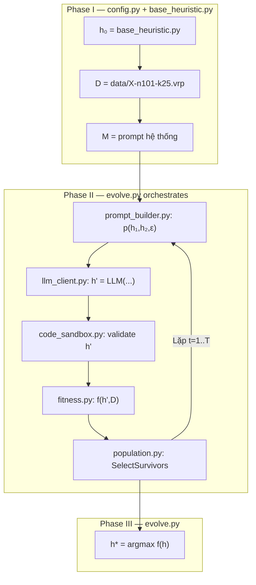

# 🚀 Hướng dẫn chạy Framework LLM-Driven Evolution cho VRP

## Cấu trúc project đã tạo xong

```
vrp_evolve/
├── config.py           ← Cấu hình (API key, tham số tiến hóa)
├── base_heuristic.py   ← Code gốc h₀ (điểm xuất phát)
├── prompt_builder.py   ← Xây prompt p(h₁, h₂, ε) cho LLM
├── llm_client.py       ← Gọi Gemini API → sinh code mới h'
├── code_sandbox.py     ← Validate & compile code an toàn
├── fitness.py          ← Đánh giá f(h, D) trên instance VRP
├── population.py       ← Quản lý quần thể P^t
├── evolve.py           ← ★ FILE CHÍNH — chạy toàn bộ 3 Phase
├── data/
│   └── X-n101-k25.vrp  ← Dữ liệu VRP (đã copy sẵn)
├── generated_code/     ← Lưu code do LLM sinh ra
└── results/            ← Kết quả cuối cùng
```

## Mối liên hệ giữa code và sơ đồ framework



> [!IMPORTANT]
> ## Bạn chỉ cần làm DUY NHẤT 1 việc trước khi chạy:
> ### Lấy API key Gemini (miễn phí) và dán vào `config.py`

## Hướng dẫn lấy API key Gemini (2 phút)

1. Truy cập **[https://aistudio.google.com/apikey](https://aistudio.google.com/apikey)**
2. Đăng nhập bằng tài khoản Google
3. Bấm **"Create API key"** → Chọn project bất kỳ → Copy key
4. Mở file [config.py](file:///C:/Users/OS/OneDrive/Desktop/Python/vrp_evolve/config.py) và thay:
   ```python
   GEMINI_API_KEY = "YOUR_API_KEY_HERE"  # ← Dán key vào đây
   ```

## Cách chạy

Mở Terminal, `cd` vào thư mục project và chạy:

```powershell
cd "C:\Users\OS\OneDrive\Desktop\Python\vrp_evolve"
python evolve.py
```

## Kết quả bạn sẽ thấy

```text
╔══════════════════════════════════════════════════════════════╗
║   LLM-DRIVEN EVOLUTIONARY HEURISTIC GENERATION FOR VRP     ║
╚══════════════════════════════════════════════════════════════╝

  PHASE I: DOMAIN-AWARE INITIALIZATION
  ✓ X-n101-k25.vrp: 100 khách hàng, 100 xe
  ✓ h₀ compile & smoke test thành công
  ✓ Fitness h₀ = 28,000

  PHASE II: LLM GENERATION — VÒNG LẶP TIẾN HÓA
  ─── THẾ HỆ 1/10 ───
    [LLM] Đang gọi Gemini API...
    ✓ Compile thành công
    ★ Fitness = 27,500    ← Cải thiện!

  ─── THẾ HỆ 2/10 ───
    ...

  PHASE III: SOLUTION SELECTION
  ★★★ HEURISTIC TỐT NHẤT: h* ★★★
  Fitness: 26,800
  → Code h* đã lưu tại: results/best_select_parents.py
```

## Giải thích từng file làm gì

| File | Vai trò trong sơ đồ | Chức năng |
|------|---------------------|-----------|
| [config.py](file:///C:/Users/OS/OneDrive/Desktop/Python/vrp_evolve/config.py) | Cấu hình toàn bộ | API key, số thế hệ T, kích thước quần thể N, thời gian HGS |
| [base_heuristic.py](file:///C:/Users/OS/OneDrive/Desktop/Python/vrp_evolve/base_heuristic.py) | h₀ ∈ H | Code `select_parents` đơn giản nhất — điểm xuất phát |
| [prompt_builder.py](file:///C:/Users/OS/OneDrive/Desktop/Python/vrp_evolve/prompt_builder.py) | p(h₁, h₂, ε) | Ghép 2 code cha mẹ + ngữ cảnh thành prompt REASON/ACT/REFLECT |
| [llm_client.py](file:///C:/Users/OS/OneDrive/Desktop/Python/vrp_evolve/llm_client.py) | h' = LLM(p; Θ) | Gọi Gemini API, nhận response, trích xuất code Python |
| [code_sandbox.py](file:///C:/Users/OS/OneDrive/Desktop/Python/vrp_evolve/code_sandbox.py) | valid. check | Kiểm tra cú pháp, chữ ký hàm, chạy smoke test |
| [fitness.py](file:///C:/Users/OS/OneDrive/Desktop/Python/vrp_evolve/fitness.py) | f(h, D) | Chạy HGS với heuristic h trên tất cả instance VRP, tính chi phí trung bình |
| [population.py](file:///C:/Users/OS/OneDrive/Desktop/Python/vrp_evolve/population.py) | P^t, SelectSurvivors | Lưu trữ quần thể, chọn cha mẹ, loại bỏ cá thể kém |
| [evolve.py](file:///C:/Users/OS/OneDrive/Desktop/Python/vrp_evolve/evolve.py) | ★ Main loop | Kết nối tất cả: Phase I → Phase II (loop T) → Phase III |

> [!TIP]
> **Muốn chạy nhanh để test?** Trong [config.py](file:///C:/Users/OS/OneDrive/Desktop/Python/vrp_evolve/config.py), đặt:
> - `NUM_GENERATIONS = 3` (3 thế hệ thay vì 10)
> - `HGS_TIME_LIMIT = 5` (5 giây thay vì 10)
> - `NUM_EVAL_RUNS = 1` (1 lần thay vì 2)
>
> Tổng thời gian chạy sẽ chỉ khoảng **5-10 phút** thay vì 30+ phút.

> [!WARNING]
> **Gemini API miễn phí** có giới hạn **15 requests/phút** và **1500 requests/ngày**.
> Với cấu hình mặc định (10 gen × 3 offspring = 30 lần gọi), bạn hoàn toàn trong phạm vi miễn phí.
